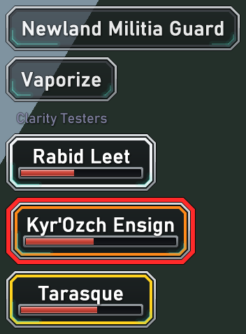
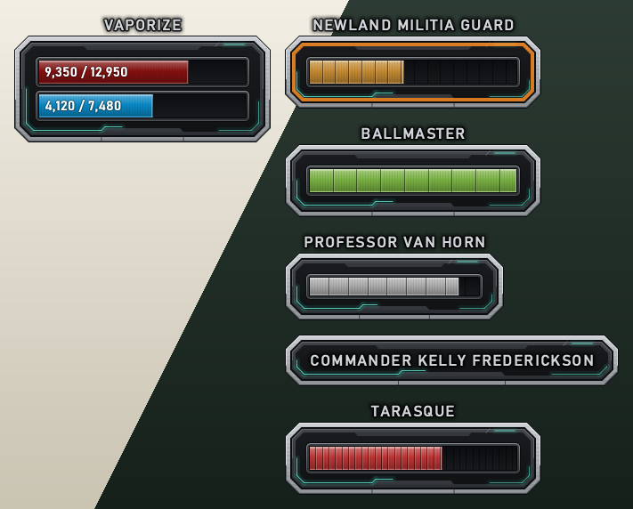

# Clarity

Clarity is a UI mod for the Anarchy Online client. It's one DLL (`dinput.dll`) that you drop into the client folder.

## Features
- **Floating combat text.**
  - Large, outlined damage and heal numbers that stay the same size on screen at any distance.
  - Crits pop and shake, and glancing hits are drawn smaller. Special attack, perk and taunt names ("Fling Shot!") are small, about the game's own size.
  - Heals in green, nano in blue; "Miss" when your attack misses and "Evade" when an attack on you misses.
  - Things the game only puts in chat get numbers too: nano you gain, heals and nano you give, health and nano drains.
  - Numbers on you are signed: -damage taken, +heals and gains.
  - Several hits on one target start side by side and rise straight up from where they happened.
  - Per category, you choose whose numbers you see (yours, your pet's, other players'). Other players' special attack and perk names are hidden, and nano damage with no known source is never shown.
- **Nameplates.**
  - Readable plates over players, NPCs and pets: the name (with its title) in a frame like the bars', and the org under it. Your nano and fight targets' plates also have a health bar, in the game's colours by level.
  - Your selected (nano) target and your fight target get a coloured frame (white, orange, gold when they are the same character), are drawn a little bigger than other plates (adjustable), and stay visible beyond the 30 m tag range, up to 80 m.
  - Characters attacking you get a slowly blinking red border.
  - Ctrl+Shift+U hides the game's interface (windows, chat, bars) and keeps the nameplates and combat text, e.g. for screenshots. The key is set in Clarity.ini (`[Interface] HideUiKey`).
  - Overlapping plates are moved apart calmly and keep their order, they don't bob with walking, and you can click a plate to select that character.
  - Like the game's own tags, plates are hidden behind walls and terrain, but not behind other characters.
  - Switch players, NPCs or pets off to get the game's own tags for them.
  - Works with ao-vk: plates are drawn after its shadows and effects.

  

- **Frames** in place of the game's health, nano and target bars (off by default: Options > Clarity > Frames).
  - Metal frames for you, your fight target and your nano target, each with the name above it in full, readable on bright and dark ground.
  - Your health over your nano, in your interface skin's colours (health a deeper red), with the amounts (e.g. 9,350 / 12,950).
  - Target health bars are coloured by how the target's level compares to yours, in the game's colours, and have as many sections as the game's target bar for that much health. No numbers.
  - Your fight target's frame has a slowly pulsing orange ring. Your nano target's frame is a little smaller while you have a fight target, and takes the fight target's place when you don't.
  - A small frame with the name of whoever your nano target is targeting (which can be you).
  - Drag a frame to move it. Once the frames are locked, click one to make that character your nano target.
  - While the frames are on, the game's own bars are hidden and its Show Nano Target / Show Fight Target / Show Target's Target options are greyed out. Turn the frames off to get them back.
  - Settings: Enabled, Locked and Size.

  

  The pictures are drawn by Clarity's own code; the names and values in them are examples.

- **Settings tab.** The game's Options window gets a **Clarity** tab, and changes apply immediately. Everything is also in `Clarity.ini`: fonts, colours and the finer settings.

## Install
**With [AoForge](https://github.com/bgf122/AoForge) (recommended):** install Clarity from the addon list. AoForge also handles updates and uninstalling.

**By hand:**
1. Download `Clarity-<version>.zip` from [Releases](../../releases).
2. Close the game.
3. Copy `dinput.dll` into the client folder, the one that contains `AnarchyOnline.exe`.
4. Start the game. Clarity creates `Clarity.ini` and `Clarity.log` next to the DLL.

If the folder already has a `dinput.dll` from another mod, don't overwrite it. Clarity and that mod can't both use the name.

## Uninstall
Close the game and delete `dinput.dll`. You can also delete `Clarity.ini` (your settings) and `Clarity.log`.

## Compatibility
- **Works alongside** [AOReloaded](https://github.com/wannabuh/AOReloaded) (`version.dll`) and [ao-vk](https://github.com/wannabuh/ao-vk) (`randy31.dll`).
- **Client updates.** Clarity finds some game functions by their byte patterns. If a client update changes them, the affected features switch themselves off and say so in `Clarity.log`, and the game keeps running normally. A Clarity update fixes that.
- It only loads into `AnarchyOnline.exe`.

## Settings
Open **Options → Clarity** in game, or edit `Clarity.ini` while the game runs: the file is reloaded automatically. The sections are:
- `[FloatingText]`: sizes, timing, outline, which categories are shown, font;
- `[Colors]`: per-colour overrides;
- `[Nameplates]`: on/off, sizes, opacity, overlapping, and which plates (players, NPCs, pets);
- `[Bars]`: the frames: on/off, locked, size, and where each frame is.

If something looks wrong, set `Debug=1` under `[FloatingText]` and include `Clarity.log` in your report.

## Building from source
Requirements: Visual Studio 2022 with the C++ workload. The DLL is 32-bit.
```
cmake -S . -B build -G "Visual Studio 17 2022" -A Win32 -DDEPLOY_DIR=<test client folder>
cmake --build build --config Release
```
- `DEPLOY_DIR` is optional. When it's set, the built `dinput.dll` is copied there.
- `python tools/verify_sigs.py <client folder>` checks the byte signatures against a client. It needs `pip install pefile`.
- Pushing a `v*` tag builds a release on GitHub Actions.

## Licence
MIT, see [LICENSE](LICENSE). Clarity includes MinHook; see [THIRD_PARTY_NOTICES.md](THIRD_PARTY_NOTICES.md).

Clarity is a fan project. It is not affiliated with or endorsed by Funcom. Anarchy Online is a trademark of Funcom.
